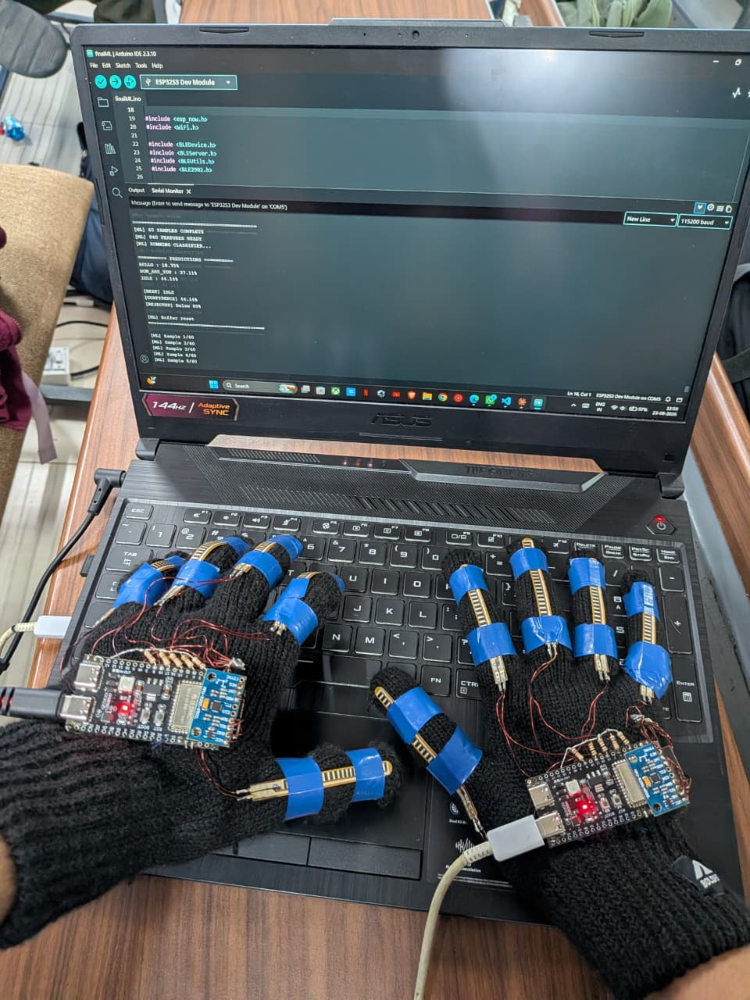
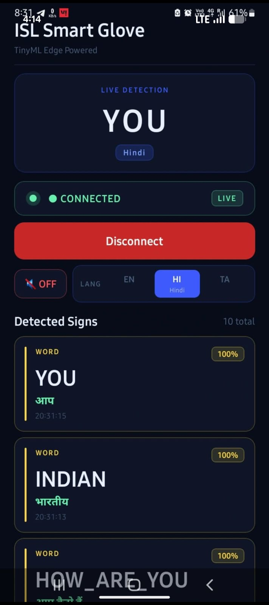
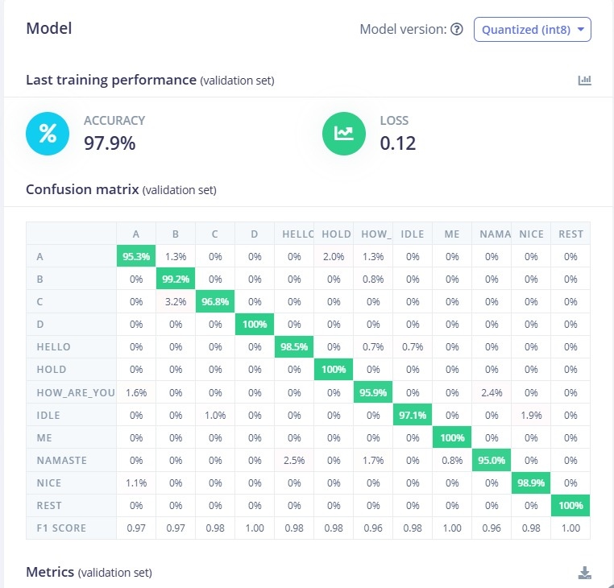

# Vakya: Indian Sign Language to Voice Translator

A low-cost wearable smart glove that translates Indian Sign Language (ISL) gestures into on-screen text and spoken audio in real time. Gesture classification runs **on the ESP32-S3 itself** (TinyML via Edge Impulse), so it works offline with no camera and no cloud.

*Vakya* means "sentence" in Sanskrit. Built as a first-year team project at VIT Chennai.

<p align="center">       </p>

## Demo

- Demo video: [`media/demo.mp4`](media/demo.mp4)
- Glove in use:- Glove photos: [`media/glove-photo-1.jpeg`](media/glove-photo-1.jpeg)

## How it works

```
Flex sensors (x5 per glove) + IMU  ->  ESP32-S3  ->  Edge Impulse model (on-device)
                                           |
Left glove --ESP-NOW--> Right glove (ESP32-S3) --BLE--> Android app --> text + Text-to-Speech
```

1. Each glove reads five flex sensors (finger bend) and an IMU (hand pitch/roll).
2. The left glove sends its readings to the right glove over **ESP-NOW**.
3. The right glove combines both hands into a **14-feature sample**, collects a window of **60 samples at 20 Hz (840 features)**, and runs the Edge Impulse classifier.
4. If the top prediction has confidence of **80% or more**, the label is sent over **BLE** to the Android app.
5. The app shows the word and speaks it with Android's built-in Text-to-Speech. The app supports English, Hindi and Tamil output.

## Model results (Edge Impulse)

The final model is a small dense neural network, quantized to int8.

| | |
|---|---|
| Validation accuracy | **97.9%** |
| Loss | 0.12 |
| Classes (12) | A, B, C, D, HELLO, HOLD, HOW_ARE_YOU, IDLE, ME, NAMASTE, NICE, REST |



Earlier iterations (13 classes including BYE, DEAF, INDIAN, PRACTICE, YOU) reached 84.5% and 77.2% validation accuracy. Adding `IDLE`/`HOLD`/`REST` classes and collecting more data improved results. Those screenshots are in [`edge-impulse/screenshots/`](edge-impulse/screenshots/).

## Hardware

- 2x ESP32-S3 DevKitC-1 (one per glove)
- 10x resistive flex sensors (2.2 inch), with voltage-divider resistors
- IMU module on each glove (I2C, address 0x68)
- Li-Po battery + charger + 3.3 V regulator
- Fabric gloves
- Android phone (for the companion app)

Pin mapping used in the firmware (right glove): Thumb GPIO 17, Index GPIO 8, Middle GPIO 6, Ring GPIO 4, Pinky GPIO 15, I2C SDA GPIO 2, SCL GPIO 1.

## Repository layout

```
firmware/
  right_glove_final/      Final firmware: sensors + ESP-NOW + Edge Impulse inference + BLE
  prototypes/             Earlier versions (ESP-NOW only, BLE to app, first ML version)
calibration/              Sketches to read raw flex values and find straight/bent limits
data_collection/          Python BLE data collector that logs labelled samples to CSV
edge-impulse/screenshots/ Training results and confusion matrices
media/                    Demo video and photos
```

## Getting started

### 1. Flash the glove firmware (Arduino IDE)

1. Install the ESP32 board package and select your ESP32-S3 board.
2. Export your trained model from Edge Impulse as an **Arduino library** and install it. The final sketch expects a library named `VAKYA_ISL_Smart_Glove_inferencing` (the Edge Impulse library is not included in this repo; train and export your own).
3. Run a calibration sketch from `calibration/` and update the `{STRAIGHT, BENT}` values in the firmware for your own sensors.
4. Open `firmware/right_glove_final/right_glove_final.ino` and upload it.

The sketch checks at compile time that the model expects 60 samples x 14 features (840 values). If you retrain with a different window, update those constants.

### 2. Collect your own training data

```bash
cd data_collection
pip install -r requirements.txt
python collect_data.py
```

Type a sign name and the script records 10 recordings of 100 samples each into `isl_training_data.csv`. Upload the CSV to Edge Impulse to train.

Our dataset is included in this repo: [`data_collection/isl_training_data.csv`](data_collection/isl_training_data.csv). Columns: `label` plus 14 features, which are the five flex sensors (thumb, index, middle, ring, little finger) and the hand's pitch and roll, for the right (R) and left (L) hands. This file has no timestamp column.

> Note: the collector connects to a BLE device named `Vakya_Glove_S3` using the Nordic UART characteristic and expects 14 comma-separated values per packet. Match your firmware's BLE name and UUID to the ones in the script (or edit the script).

## Known limitations

- Recognizes static signs; dynamic (moving) signs are future work.
- Small vocabulary (12 classes) and a small team-collected dataset, so accuracy for new users may be lower than the validation score.
- Per-sensor calibration values are specific to our gloves.

## Future work

Larger vocabulary and more users, dynamic gesture recognition with temporal models, a custom PCB, iOS app, and sentence-level output.

## Team

Built by a five-member multidisciplinary team (CSE, ECE, Mechatronics):
Ishan Chaudhary (hardware integration and embedded ML), Aayush Singh, Manasvi Singh, Vardaa Maheshwari, Aadi Vibhuti.

Supervised by Dr. Vasugi K., VIT Chennai.

## License

MIT. See [LICENSE](LICENSE).
